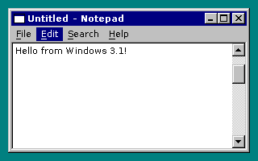
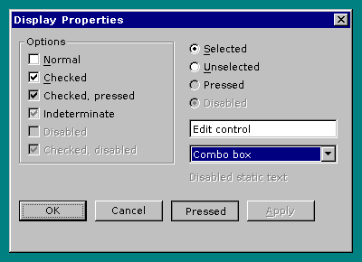
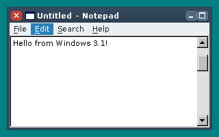

# win31_theme_engine

Open-source, themeable engine that brings the Windows 95 look (and custom, skinnable themes) to
Windows 3.1 and Windows for Workgroups 3.11. Working name: Retheme16.





*Previews rendered on Linux by the engine's own renderer (`make preview`).*

## Download

Releases with the installer (`SETUP.EXE`, as ZIP and as 1.44 MB floppy image) are on the
[Releases page](https://github.com/ceisserer/win31_theme_engine/releases). Unzip, run `SETUP.EXE`, pick a theme.
The pre-release [snapshot](https://github.com/ceisserer/win31_theme_engine/releases/tag/snapshot) is rebuilt from
every push to the default branch (untested, for trying out the latest changes).

## Documents

* [docs/IMPLEMENTATION_PLAN.md](docs/IMPLEMENTATION_PLAN.md): architecture, theme format, test strategy, phases
* [docs/STATUS.md](docs/STATUS.md): what is implemented and verified
* [docs/THEME_FORMAT.md](docs/THEME_FORMAT.md): how to write a theme
* [docs/BUILDING.md](docs/BUILDING.md): building, testing, installing
* [docs/REQUIRED_TOOLS.md](docs/REQUIRED_TOOLS.md): tools and software needed, and which of it has been provided

## Layout

```
engine/include, theme, render, geom   portable core (C, builds with gcc and Open Watcom 16-bit)
engine/win16                          RETHEME.DLL runtime: patches, hooks, GDI backend
loader/                               RETHEME.EXE
testapp/                              GALLERY.EXE test scenes
dist/                                 release package: SETUP.INF (installer configuration), README.TXT
external/win16setup                   SETUP.EXE installer (git submodule: Win16Setup)
host/                                 Linux backend, previewer, tests, golden images
themes/                               themes: WIN95 (default), WIN98, SLATE
tools/                                generators, emulator tests (tools/emu), release packaging (tools/release)
```

Quick start: `git submodule update --init && make test && make preview && make win16` (see [docs/BUILDING.md](docs/BUILDING.md)).

## License

Retheme16 is free software under the GNU General Public License, version 3 or (at your option) any later version;
see [LICENSE](LICENSE). The installer, [Win16Setup](https://github.com/ceisserer/Win16Setup), is GPL-3.0 as well.
